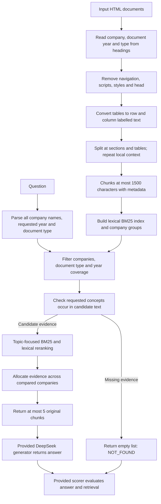

# FTEC5660 Homework 4

A lexical RAG retrieval pipeline for company reports. The answer generator is the fixed implementation supplied in `hw4.py`; the student implementation controls table parsing, chunking, query parsing, indexing, retrieval and abstention.

## Setup and reproduction

Use Python 3.10 or newer. From the repository root:

```bash
python3 -m venv .venv
source .venv/bin/activate
python -m pip install -r requirements.txt
```

Create a local `.env` with your own `DEEPSEEK_API_KEY` entry, then run:

```bash
python hw4.py --data-folder public_test
```

This produces `results.csv`. To repeat the complete Task 5 experiment:

```bash
python ablation.py --data-folder public_test --out-dir experiments
```

For inspection without model calls, use a different output directory so that measured answer results are preserved:

```bash
python ablation.py --retrieval-only --out-dir offline_checks
```

Individual variants can be selected with `--variants B0 V1`, for example. Every full experiment invokes the supplied generator and uses the local API key. `.env`, `.venv`, caches and index files are excluded from Git. No index is saved: every run builds one from the corpus it receives. The final code uses only dependencies already listed in `requirements.txt`. `experiments/environment.txt` records the package versions used for the measurements.

## Homework 4 solution

### Pipeline and design



`table_to_text` includes the caption and serializes each row with its column labels, retaining the printed strings, commas and parentheses. `chunk_document` extracts metadata from the document itself, removes boilerplate, and uses section and table boundaries before recursive splitting. Section headings and table captions are repeated as short local context; every chunk stays within 1,500 characters. `parse_query` uses grammatical patterns and regular expressions to extract company subjects, including companies absent from the corpus, the requested year and the appropriate source type. `build_index` builds BM25 and exact normalized company groups entirely in memory. Retrieval first filters by company, type and year coverage, then ranks topic evidence and distributes up to five original chunks across the requested companies. It returns an empty list if the company/year candidates are unavailable or requested concept tokens are absent. No embedding model, external data source or student-side model call is used. The supplied generator sees only the retrieved chunks.

### Implementation details

**Metadata and year coverage.** Company names come from the HTML `h1`, with a trailing ticker removed; legal suffixes are ignored for entity matching. The document year is extracted from the report or call heading, not from the publication date. The query year remains the year requested in the question. An annual-report candidate may have that document year or the following year, because annual tables include prior-year figures. For calls and research notes, a matching document year is accepted; otherwise the requested year must occur in the chunk, allowing outlook and estimate questions. This avoids requiring a nonexistent FY2023 document to answer an FY2023 value shown in an FY2024 report.

**Lexical retrieval.** Normalization removes question scaffolding, maps selected general synonyms and abbreviations, and applies a simple plural normalization. For the final ranking, the company names, date scaffolding and explicit source phrases are removed from the ranking query. Scores combine BM25 with 10 times topical token coverage, 2 for each matching adjacent query-token pair, a 3-point exact document-year preference and a 3-point preference for annual-report table chunks on suitable financial questions. Questions about a person, headquarters or an auditor do not receive that table preference. A small recency preference is used when no year is requested. The score constants are fixed in the student helper; no question-specific answer is embedded.

**Comparisons and abstention.** Company matching uses full normalized names, so companies sharing one word are kept distinct. Round-robin allocation gives each compared company a place in the five-chunk budget. Candidate filtering already rejects unknown companies and unsupported historical years. A final coverage rule rejects a question if any normalized topical concept is absent from that company's candidate chunks. This is a lexical answerability heuristic, not proof that all required facts are stated together; the generator must still judge the actual evidence. Returned chunks are original objects from `chunk_document`, with no rewritten or fabricated evidence.

### Task 5: cumulative ablation study

All configurations use the same 40 public documents, 60 questions and supplied generator (`deepseek-v4-flash`, temperature 0, thinking disabled). There are 46 answerable and 14 unanswerable questions. Each row changes one component relative to the row immediately above it; earlier changes remain enabled. There is one measured run per configuration, not a statistical average. Answer accuracy is measured across all 60 questions; recall is measured on the 46 answerable questions. `Kept` is the fraction of answerable questions receiving chunks; `Rejected` is the fraction of unanswerable questions receiving an empty list. The final column is the automatic Tasks 1-4 score out of 75, not the complete homework grade.

| Variant | Component changed from preceding row | Chunks | Recall@5 | Kept | Rejected | Answer accuracy | Auto /75 |
| --- | --- | ---: | ---: | ---: | ---: | ---: | ---: |
| B0 | Naive get_text fixed chunks whitespace BM25 global top-5 | 222 | 37.0% | 100.0% | 0.0% | 46.7% | 21.33 |
| V1 | table serialization | 257 | 37.0% | 100.0% | 0.0% | 51.7% | 30.33 |
| V2 | navigation/head/style/script removal | 251 | 39.1% | 100.0% | 0.0% | 51.7% | 30.33 |
| V3 | section/table boundaries for chunking | 1115 | 34.8% | 100.0% | 0.0% | 48.3% | 29.67 |
| V4 | repeated local section/caption context | 1115 | 30.4% | 100.0% | 0.0% | 45.0% | 29.00 |
| V5 | lexical token normalization | 1115 | 19.6% | 100.0% | 0.0% | 38.3% | 27.67 |
| V6 | query parsing and metadata candidate filtering | 1115 | 67.4% | 100.0% | 71.4% | 75.0% | 58.66 |
| V7 | topic-focused lexical reranking | 1115 | 100.0% | 100.0% | 71.4% | 100.0% | 72.14 |
| V8 | per-company round-robin allocation | 1115 | 100.0% | 100.0% | 71.4% | 100.0% | 72.14 |
| V9 | missing-concept abstention (production configuration) | 1115 | 100.0% | 100.0% | 100.0% | 100.0% | 75.00 |

The exact baseline B0 uses BeautifulSoup `get_text(" ", strip=True)`, `RecursiveCharacterTextSplitter(chunk_size=1500, chunk_overlap=100)`, required metadata and lower-cased whitespace BM25 tokens over the whole corpus. It returns the global top five, performs no query parsing and never deliberately abstains. The empty starter program is not used as B0.

V1 changes table serialization only, retaining the same fixed splitter and whitespace retrieval. V2 removes navigation, head, styles and scripts only. V3 replaces fixed whole-document splitting with section/table boundaries, with no repeated context prefix. V4 adds repeated local section/caption prefixes only. V5 changes the lexical tokenizer only. V6 activates query parsing and metadata candidate filtering only; ranking still uses the full normalized question. V7 changes the ranking component to the topic-focused scoring described above. V8 changes the allocation policy to round-robin across companies only. V9 enables the missing-concept coverage rejection only, and is the production configuration used by `retrieve`.

`ablation.py` implements these switches, sharing the production chunking and retrieval helpers. Each variant saves question-level `results.csv` and `metrics.json` under `experiments/<variant>/`; `experiments/summary.csv` aggregates them. Public expected answers and evidence are read by the evaluation portion only and are never passed to parsing, indexing, ranking or abstention. The generator and the code below the provided-code boundary are unchanged.

### What the ablations show

- **B0 to V1:** recall remains 37.0%, while answer accuracy improves from 46.7% to 51.7%. Clear row/column relationships help the generator interpret retrieved text, even when the evidence-hit measure does not improve. Table-cell scoring also rises from 0% to 100%.
- **V1 to V2:** boilerplate removal slightly improves recall to 39.1%, but answer accuracy stays at 51.7%. Cleaner input alone does not solve company and year confusion.
- **V2 to V3:** structural splitting reduces recall to 34.8% and accuracy to 48.3%. It produces more, smaller candidates, which changes BM25 statistics and can separate a question's required evidence across chunks. This run does not support claiming that smaller structural chunks alone improve retrieval.
- **V3 to V4:** repeated context reduces recall further to 30.4% and accuracy to 45.0% under global whitespace retrieval. Repeated headings affect term frequencies and rankings; their presence is useful context for later stages but is not an isolated retrieval gain here.
- **V4 to V5:** tokenizer normalization lowers recall to 19.6% and accuracy to 38.3%. In this configuration, removing numerical tokens weakens global year discrimination, and generic normalized terms still compete across companies. This is an interaction with the absence of metadata filtering, rather than evidence that token normalization is universally beneficial.
- **V5 to V6:** metadata filtering raises recall to 67.4% and accuracy to 75.0%; query parsing is correct on all 180 public fields. Ten of the 14 unanswerable questions are rejected through company/year availability, giving 71.4% rejection. Exact entity and temporal constraints are the largest improvement at this stage.
- **V6 to V7:** topic-focused ranking raises recall and answer accuracy to 100%. Within an already filtered company/year pool, ranking the requested metric rather than repeated company names finds the needed evidence. This experiment measures the ranking component as a whole; it does not isolate each score bonus.
- **V7 to V8:** measured recall and answer accuracy remain at 100%. Round-robin allocation provides explicit coverage across companies, but this public run shows no additional accuracy gain because the previous rankings already fit the necessary evidence into five chunks.
- **V8 to V9:** recall and answer accuracy remain at 100%, while rejection rises from 71.4% to 100%. The generator had already answered `NOT_FOUND` correctly on the four undisclosed-metric questions, but V9 rejects them before generation. This improves Task 3 and reduces generator calls from 50 to 46.

These are cumulative, order-dependent ablations. They show the effect of each addition in the preceding configuration, rather than its independent effect in every possible combination. A single run also cannot separate all generation variability from the effect of a changed context.

### Error analysis and final results

The saved rows illustrate several distinct failures:

| Example | Observed failure | What changed |
| --- | --- | --- |
| B0, `q001` | A question about the absent company Northgate Robotic Systems retrieves Northgate Robotics documents and produces `241.6` rather than `NOT_FOUND`. | Full-name metadata matching avoids substituting a similarly named company. |
| B0, `q021` | The two-company cash comparison misses complete required evidence and the generator answers `NOT_FOUND`. | Filtering and topic ranking supply the correct cash evidence; the allocation policy explicitly preserves both companies. |
| V6, `q040` | The correct annual-report file is retrieved, but the selected chunks miss the inventory value and the answer is `NOT_FOUND`. | Topic reranking fixes the chunk-level evidence selection. Correct document selection alone is insufficient. |
| V8, `q019`, `q025`, `q033`, `q039` | Chunks are returned for undisclosed metrics, even though the generator ultimately answers `NOT_FOUND` correctly. | The final coverage rejection returns an empty list for these questions. |

The production configuration V9 obtains **60/60 correct answers**, **46/46 evidence hits**, keeps **46/46 answerable questions**, and rejects **14/14 unanswerable questions** in the saved public experiment. All 12 table tests score 100%, and all 40 document checks pass. The automatic total is **75/75**. The final index contains 1,115 chunks; the longest chunk is 1,498 characters. Parsing and retrieval make zero model calls; V9's generator makes 46 calls. The supplied token-based estimate for that run is approximately **USD 0.0093**; this is an estimate, not an account invoice.

Public success does not guarantee the private score. The parser is rule-based and may miss unfamiliar grammatical forms. The abstention rule can falsely reject an answerable paraphrase if its concept tokens are not covered by the synonym mapping, or accept a question whose words appear separately without the requested relationship. The current table parser assumes the supplied simple row/column layout rather than arbitrary merged-cell tables. Future work should test broader wording and contradictory or incomplete evidence, rather than encode public question IDs or answers in retrieval.

### Clean-environment verification

The final source was exported into a separate clean directory with the supplied public corpus, without `.env`, an existing virtual environment or a saved index. A new virtual environment was created and dependencies were installed from `requirements.txt`. The existing local API key was loaded into process memory for the test. The unmodified provided runner rebuilt the index and completed an end-to-end run with **60/60 correct answers and 75/75 automatic points**, in approximately **7.0 seconds**. This is a clean source-export test rather than a test of a published commit; remote submission remains a separate step. `results.csv` in the working project is from this verification run, while the per-variant files retain the measured ablation runs.

### Task 6: Reflection

The reflection below focuses on continuous learning, creativity and exploration. A separately uploadable PDF is available as [Reflection.pdf](Reflection.pdf).

Ten years from now, if personal AI agents can write, program, research and make sophisticated decisions, I would still want to be a curious learner. My aim would be to ask worthwhile questions, create something original and explore what I do not yet understand. Having access to powerful answers would make my choice of questions more important, rather than remove the need to think.

The ambitions I would keep are continuous learning, creativity and exploration. I would want to understand ideas well enough to connect them across fields and use them to develop something meaningful. Professional success could still matter, but I would judge it partly by whether my work helps me discover something or offers something useful to others, rather than simply by how much I produce.

Beyond productivity and professional achievements, I would want to be known as someone who is curious, generous with knowledge and open to being wrong. I would value listening carefully, giving others credit and making room for unfamiliar perspectives. These qualities would shape how I learn and collaborate, even when an agent can perform many individual tasks faster than I can.

I would still be willing to struggle with understanding a difficult idea and developing my own creative voice. An agent could provide a finished solution, but the process of making an attempt, encountering a mistake and revising my approach could change my understanding. I would accept assistance while sometimes choosing to attempt a problem independently, because the experience of learning would itself be part of the goal.

The qualities I would develop include framing problems, evaluating evidence, connecting ideas and making thoughtful choices about what deserves attention. I would also value the ability to work with people and explore beyond my usual interests. Using AI well would involve questioning its suggestions and checking important claims, rather than treating fluent explanations as proof of understanding or replacing every uncertain decision with a recommendation.

If my value were no longer defined mainly by what I can do, I would define myself through what I care about, what I choose to learn and how I act toward others. I would not need to outperform an agent at every task to have a meaningful identity. I would want my projects and relationships to express curiosity, creativity and a willingness to take responsibility for my choices.

Starting tomorrow, I could keep a small journal of questions that interest me, choose one to investigate each week and build or write something from what I learn. Before asking AI for a complete solution, I could record my own attempt; afterward, I could explain the result in my own words. This would turn AI assistance into an opportunity to deepen learning while leaving room for exploration without an immediate productivity target.
